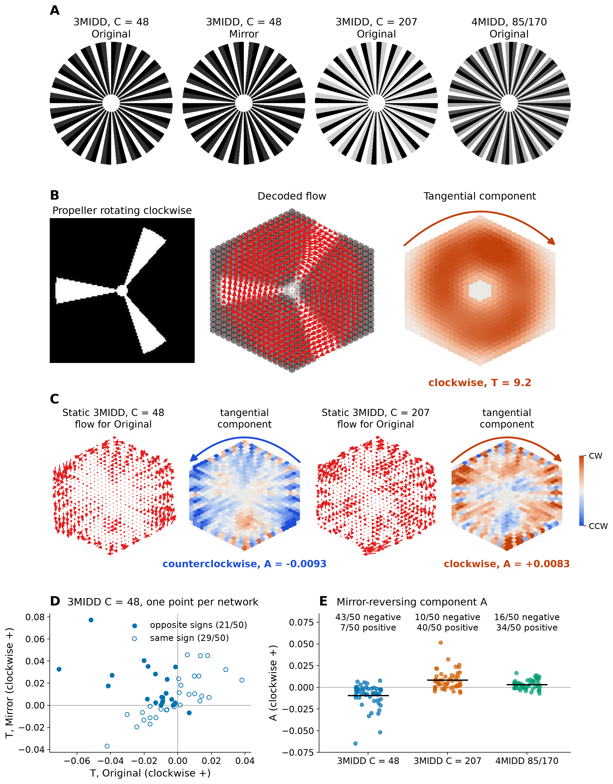

# MIDD × FlyVis

**Illusory-motion signals emerge in a connectome-constrained model of the fly visual system trained on optic flow**

[Manuscript (PDF)](manuscript/flyvis_midd_manuscript_V8.pdf) · [Manuscript source](manuscript/manuscript_V8.md)

This repository contains the manuscript, stimuli, analysis code, processed results, and figures of a study of how FlyVis networks, trained only to estimate optic flow, respond to static motion illusion-like discrete design (MIDD) patterns.



## Abstract

Stationary patterns with repeating asymmetric luminance steps appear to move, and both humans and flies respond to them. We asked whether such responses arise in FlyVis, a recurrent network whose wiring follows the fly visual connectome and which is trained only to estimate optic flow from naturalistic video. We presented static motion illusion-like discrete design (MIDD) disks, previously used in human psychophysics, and read out the decoded flow. At initialization the direction-dependent rotational component was absent ($|A|<3\times10^{-9}$); it appeared during ordinary optic-flow training, although no MIDD was in the training set. Its direction depended on the luminance of the intermediate sector: negative for a dark gray (43 of 50 pretrained networks) and positive for a light gray (40 of 50), and the same signs appeared in 14 networks trained from scratch (12/14 and 13/14). As in human observers, the response to four-level patterns followed from the difference between responses to their three-level components (mean held-out $R^2=0.90$), and this rule held within each network even though the component responses differed between networks. The response was about three orders of magnitude smaller than that to physical rotation, varied with stimulus phase, was not restricted to MIDD patterns, and depended on the learned pairing of network and decoder. A circuit model built from the fly connectome and a generic motion task thus acquires a structured response to static patterns that shares the luminance-dependent reversal and the summation rule described for human illusory motion.

## Main findings

- **The response is learned.** At initialization the direction-dependent rotational component $A$ of the decoded flow is absent ($|A|<3\times10^{-9}$). It appears during ordinary optic-flow training, although no MIDD is in the training set.
- **Luminance sets the direction.** For three-level patterns, $A$ is negative when the intermediate sector is dark gray (43 of 50 pretrained networks) and positive when it is light gray (40 of 50). Networks trained from scratch show the same signs (12/14 and 13/14).
- **A summation rule links three-level and four-level patterns.** The response to a four-level pattern follows from the difference between the responses to its two three-level components, $A_4 \approx \alpha\,[A_3(C_1)-A_3(C_2)]+\beta$ (mean $R^2=0.93$, held-out $R^2=0.90$), as described for human observers by Kobayashi & Watanabe (2023).
- **The rule is shared; the amounts are individual.** Networks with identical wiring differ in the sign and size of their responses and keep their relative ordering across stimulus phases (ICC 0.76). Each network's own three-level responses predict its four-level responses.
- **The response belongs to the motion pathway and its readout.** It changes when T4/T5 activity is replaced and when networks and decoders are exchanged, and it is also evoked by other static patterns. It is about three orders of magnitude smaller than the response to physical rotation.

Decoded flow is the output of the model, which we compare with human psychophysics; it is not itself a measurement of perception.

## Figures

| Figure | Topic | Image | Notebook of the original version |
|---|---|---|---|
| Fig. 1 | Static MIDD patterns and the decoded flow | [PNG](figures/fig01/fig01_main_V2.png) | [fig_1](notebooks/fig01/fig_1.ipynb) |
| Fig. 2 | The response emerges during optic-flow training | [PNG](figures/fig05/fig05_main_V2.png) | [fig_5](notebooks/fig05/fig_5.ipynb) |
| Fig. 3 | The intermediate luminance sets the direction | [PNG](figures/fig02/fig02_main_V2.png) | [fig_2](notebooks/fig02/fig_2.ipynb) |
| Fig. 4 | Summation rule from three-level to four-level patterns | [PNG](figures/fig03/fig03_main_V2.png) | [fig_3](notebooks/fig03/fig_3.ipynb) |
| Fig. 5 | Variation with stimulus phase, sampling, and network | [PNG](figures/fig04/fig04_main_V2.png) | [fig_4](notebooks/fig04/fig_4.ipynb) |
| Fig. 6 | Motion pathway and readout | [PNG](figures/fig06/fig06_main_V2.png) | [fig_6](notebooks/fig06/fig_6.ipynb) |

Figure numbers follow the order of the manuscript; folder and file names keep the numbering of the original repository. Supplementary Figs. S1–S10 are in `figures/supplementary/figSN/figSN_main_V2.*`.

## Reproduce the figures

All figures are drawn from the bundled processed results; no pretrained networks or FlyVis inference are needed. Use Python 3.9 or newer:

```bash
git clone https://github.com/eijwat/flyvis-midd-we.git
cd flyvis-midd-we
python -m pip install -e ".[all]" scipy pillow jupyterlab
python scripts/render_figures_v2.py          # all 6 main and 10 supplementary figures
python scripts/render_figures_v2.py 1 S3     # selected figures
```

Build the manuscript PDF (requires pandoc and XeLaTeX):

```bash
python3 scripts/build_manuscript_pdf.py --source manuscript/manuscript_V8.md --figure-suffix _V2 \
    --figure-order 1,5,2,3,4,6 --plain-tables --output manuscript/flyvis_midd_manuscript_V8.pdf
```

The decoded flow fields shown in Fig. 1 are stored in `data/precomputed/fig01/fig1_flow_fields.npz`. To recompute them from the 50 pretrained networks (FlyVis 1.2.0; a CPU is sufficient), run `scripts/generate_fig1_flow_fields.py`; the recomputed tangential flow matches the stored table to within $3\times10^{-7}$.

The notebooks in `notebooks/` replay the same processed results and draw the figures of the original version. See the [reproduction map](docs/reproduction_map.md) for inputs, outputs, and verification details.

## Repository structure

- `data/` — stimuli and processed analysis inputs
- `notebooks/` — main and supplementary figure notebooks (original version)
- `src/flyvis_midd/` — shared analysis and plotting code (`figure_rendering_v2.py` draws the current figures)
- `scripts/` — figure rendering, flow-field computation, and the PDF build
- `figures/` — generated figures and numerical summaries
- `manuscript/` — manuscript, references, and PDF

## Relation to the master repository

The project was carried out by two people, E.W. and a collaborator who wishes to remain anonymous. This repository is the public fork of the project's master repository, which is kept private. The analyses, processed data, and numerical results are those of the master repository. The fork rewrites the manuscript (`manuscript_V2.md` … `manuscript_V8.md`; latest V8) and redraws the figures (`*_main_V2.*`). The original files are kept unchanged:

- [Original manuscript (PDF)](manuscript/flyvis_midd_manuscript.pdf), source `manuscript/manuscript.md`
- Original figures `figures/figNN/figNN_main.*`

### Research agents

- OpenAI GPT
- Google Gemini
- Anthropic Claude

## Documentation

- [Reproduction map](docs/reproduction_map.md)
- [Processed-data provenance](data/precomputed/PROVENANCE.md)

## Repository maintenance

`eijwat`.

## License

Code is licensed under [MIT](LICENSE); original manuscript, figures, documentation, and research data are licensed under [CC BY 4.0](LICENSE-CONTENT.md). Third-party materials are excluded and retain their original licenses.
